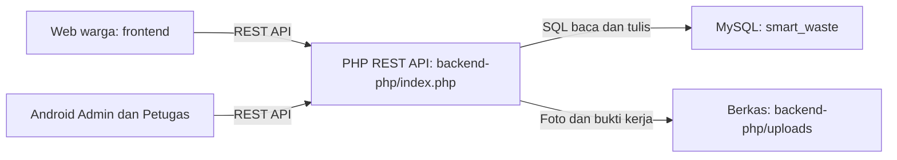
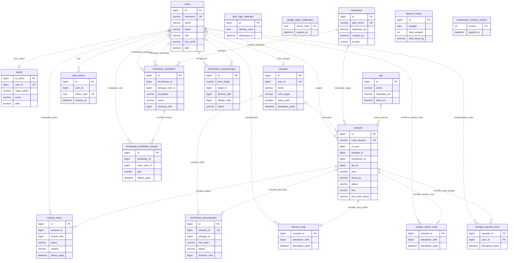

# ERD Terpadu Smart Waste

Dokumen ini menggambarkan satu alur data yang dipakai portal web warga dan aplikasi Android Admin/Petugas. Kedua client mengakses REST API PHP yang sama; keduanya tidak membuka koneksi MySQL secara langsung.

## Arsitektur akses data

Contohnya, warga membuat laporan dari web lalu laporan yang sama dibaca dan diproses Admin/Petugas dari aplikasi Android. Perubahan status, foto bukti, dan arsip disimpan melalui API ke database bersama.

## ERD database bersama

Diagram memuat **19 tabel** sesuai `database/schema.sql`. Garis putus-putus menunjukkan relasi logis berdasarkan kolom ID yang digunakan API. Skema MySQL aktif saat ini belum memasang constraint foreign key fisik; API yang mengelola pemeriksaan dan perubahan relasi.

## Akses data per platform

| Bagian | Data utama yang digunakan melalui API | Tugas |
|---|---|---|
| Web warga | `users`, `sampah`, `riwayat_status`, `konfirmasi_penyelesaian` | Daftar akun warga, kirim laporan/foto awal, pantau status dan bukti petugas. |
| Android Admin | `users`, `admin`, `petugas`, `sampah`, tabel arsip, `kendaraan`, tabel perbaikan, `tpa`, `permintaan_pengosongan`, `laporan_harian` | Kelola akun/operasional, verifikasi laporan dan bukti, persetujuan, arsip, kapasitas, dan statistik. |
| Android Petugas | `users`, `petugas`, `sampah`, `riwayat_status`, `konfirmasi_penyelesaian`, `petugas_laporan_arsip`, `kendaraan`, tabel perbaikan, `tpa`, `permintaan_pengosongan` | Terima tugas, ubah progres, kirim bukti lokasi/penyelesaian, dan kelola pekerjaan lapangan. |
| API bersama | `auth_tokens`, `auth_login_attempts`, `google_login_challenges`, serta seluruh tabel domain | Autentikasi, validasi peran, dan satu pintu baca/tulis untuk kedua client. |

Pemetaan ini menunjukkan akses fitur melalui API, bukan izin client untuk membaca tabel langsung.

## Relasi khusus dan penyimpanan foto

- `permintaan_pengosongan.jenis_target` menentukan arti `target_id`: ID tersebut merujuk ke `kendaraan.id` atau `tpa.id`. Relasi ini polimorfik sehingga tidak digambar sebagai foreign key langsung.
- `petugas.user_id` menghubungkan profil petugas ke akun pada `users`; kolom dapat kosong untuk profil yang belum punya akun.
- Foto laporan dan bukti disimpan sebagai berkas di `backend-php/uploads/`. Database menyimpan path pada kolom foto, bukan menyimpan gambar sebagai BLOB.
- `laporan_harian` adalah tabel rekap, sedangkan `smartwaste_schema_version` mencatat versi migrasi. Keduanya tidak memiliki relasi ID ke laporan individual.

## Berkas sumber

- Struktur tabel: [`schema.sql`](schema.sql) dan [`backend-php/database/schema.sql`](../backend-php/database/schema.sql).
- Snapshot data lokal: [`smart_waste.sql`](smart_waste.sql). Berisi data akun/laporan; jaga tetap pribadi dan jangan commit ke repositori publik.
